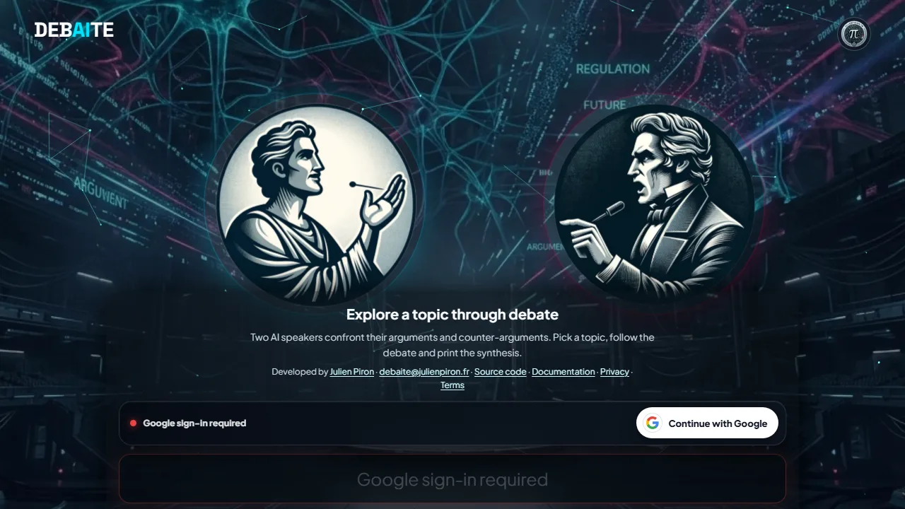

# Debaite

**A cinematic AI debate arena: one prompt, two opposing voices, one structured contradiction engine.**

[](https://julienpiron.fr/debaite/)
[](#run-it-locally)
[](LICENSE)
[](https://scorecard.dev/viewer/?uri=github.com/pironjulien/debaite)



Pick a topic, follow two AI speakers as they confront arguments and counter-arguments, then print the synthesis.
Built to help students write stronger essays by seeing the best case for both sides.

Live demo: https://julienpiron.fr/debaite/

## Run it locally

```bash
php -S localhost:8000
```

Then open http://localhost:8000. The interface loads without configuration; debates need the runtime values below in a
local `.env` file (never committed).

## What is included

- Static frontend: `index.html`, `style.css`, `script.js`
- PHP API relay: `api/generate.php`
- Google OAuth access flow: `api/google-start.php`, `api/google-callback.php`, `api/session.php`, `api/logout.php`
- Credit checkout and webhook flow: `api/checkout.php`, `api/stripe-webhook.php`
- Access, trial, credit, and mode-cost logic: `api/lib/access.php`
- WebP visual assets used by the live interface

No API key, OAuth secret, Stripe secret, password, deployment credential, runtime database, or local environment file is included.

## Required runtime configuration

Configure these values on the server or in a local `.env` file that is never committed:

```env
DEEPSEEK_API_KEY=
DEBAITE_APP_SECRET=
DEBAITE_GOOGLE_CLIENT_ID=
DEBAITE_GOOGLE_CLIENT_SECRET=
DEBAITE_GOOGLE_ALLOWED_EMAILS=
DEBAITE_GOOGLE_REDIRECT_URI=
DEBAITE_STRIPE_SECRET_KEY=
DEBAITE_STRIPE_WEBHOOK_SECRET=
```

Optional access, pricing, and model limits:

```env
DEBAITE_TRIAL_DEBATE_LIMIT=1
DEBAITE_TRIAL_STEP_LIMIT=8
DEBAITE_PUBLIC_IP_DAILY_STEP_LIMIT=40
DEBAITE_CREDIT_PACK_CENTS=99
DEBAITE_CREDIT_PACK_CREDITS=200
DEBAITE_CREDIT_PACK_CURRENCY=eur
DEBAITE_FAST_STEP_CREDITS=1
DEBAITE_THINK_STEP_CREDITS=2
DEBAITE_EXPERT_STEP_CREDITS=4
DEBAITE_EXPERT_THINK_STEP_CREDITS=6
DEBAITE_CONTACT_URL=https://twitter.com/julienpironfr
```

## Deployment notes

The app is designed for Apache + PHP and is currently served under `/debaite/`.

The `.htaccess` file blocks runtime/private files and applies a strict Content Security Policy. If you deploy under another path, review `api/lib/access.php` and the OAuth redirect URI accordingly.

## License

Licensed under the GNU Affero General Public License v3.0.

This is a strong copyleft license: if you modify Debaite and run it as a network service, you must make the corresponding source code available under the same license.
