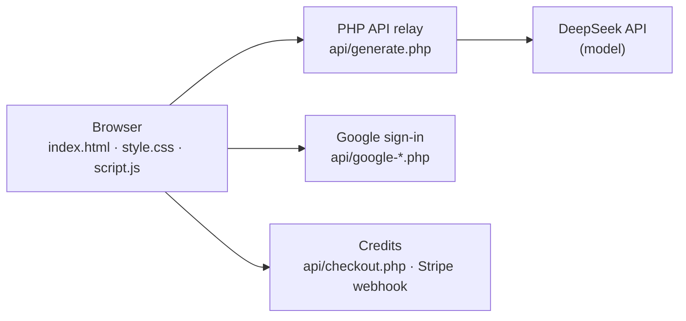

<div align="center">

# Debaite

**Explore any topic through debate.**

A cinematic AI debate arena: one prompt, two opposing voices, one structured contradiction engine.

[](https://julienpiron.fr/debaite/)
[](https://github.com/pironjulien/debaite/actions/workflows/ci.yml)
[](https://scorecard.dev/viewer/?uri=github.com/pironjulien/debaite)
[](#-run-it-locally)
[](LICENSE)

**[🌐 Try it live](https://julienpiron.fr/debaite/)** · **[🚀 Run it locally](#-run-it-locally)** · **[📝 Changelog](CHANGELOG.md)**

</div>

<div align="center">
<a href="https://julienpiron.fr/debaite/"></a>
<br><sub>The arena · <a href="https://julienpiron.fr/debaite/">try it on julienpiron.fr</a></sub>
</div>

## ✨ Why Debaite

Pick a topic, follow two AI speakers as they confront arguments and counter-arguments, then print the synthesis. Built
to help students write stronger essays by seeing the best case for both sides.

<table>
<tr>
<td width="33%">⚔️ <b>Two opposing voices</b><br>Two AI speakers argue a topic from opposite positions, thesis against counter-argument.</td>
<td width="33%">🎚️ <b>Four depth levels</b><br>Fast, Think, Expert and Expert + Think, each with its own credit cost.</td>
<td width="33%">🖨️ <b>Print the synthesis</b><br>Resume, stop, clear, then print the result of the debate.</td>
</tr>
<tr>
<td width="33%">🎓 <b>Made for essays</b><br>See the best case for both sides before you write.</td>
<td width="33%">🪶 <b>Lightweight stack</b><br>A static frontend and a small PHP API relay, served by Apache.</td>
<td width="33%">🔓 <b>Open source</b><br>AGPL-3.0, with no secret or credential in the repository.</td>
</tr>
</table>

## 🚀 Run it locally

```bash
php -S localhost:8000
```

Then open http://localhost:8000. The interface loads without configuration; debates need the runtime values below in a
local `.env` file (never committed).

<details>
<summary><b>Required runtime configuration</b></summary>

Configure these values on the server or in a local `.env` file that is never committed:

```env
DEEPSEEK_API_KEY=
DEBAITE_APP_SECRET=
DEBAITE_GOOGLE_CLIENT_ID=
DEBAITE_GOOGLE_CLIENT_SECRET=
DEBAITE_GOOGLE_ALLOWED_EMAILS=
DEBAITE_GOOGLE_REDIRECT_URI=
DEBAITE_STRIPE_SECRET_KEY=
DEBAITE_STRIPE_WEBHOOK_SECRET=
```

Optional access, pricing, and model limits:

```env
DEBAITE_TRIAL_DEBATE_LIMIT=1
DEBAITE_TRIAL_STEP_LIMIT=8
DEBAITE_PUBLIC_IP_DAILY_STEP_LIMIT=40
DEBAITE_CREDIT_PACK_CENTS=99
DEBAITE_CREDIT_PACK_CREDITS=200
DEBAITE_CREDIT_PACK_CURRENCY=eur
DEBAITE_FAST_STEP_CREDITS=1
DEBAITE_THINK_STEP_CREDITS=2
DEBAITE_EXPERT_STEP_CREDITS=4
DEBAITE_EXPERT_THINK_STEP_CREDITS=6
DEBAITE_CONTACT_URL=https://twitter.com/julienpironfr
```

</details>

## ⚙️ How it works



What is included:

- Static frontend: `index.html`, `style.css`, `script.js`
- PHP API relay: `api/generate.php`
- Google OAuth access flow: `api/google-start.php`, `api/google-callback.php`, `api/session.php`, `api/logout.php`
- Credit checkout and webhook flow: `api/checkout.php`, `api/stripe-webhook.php`
- Access, trial, credit, and mode-cost logic: `api/lib/access.php`
- WebP visual assets used by the live interface

## 🌍 Deployment notes

The app is designed for Apache + PHP and is currently served under `/debaite/`.

> [!IMPORTANT]
> The `.htaccess` file blocks runtime/private files and applies a strict Content Security Policy. If you deploy under
> another path, review `api/lib/access.php` and the OAuth redirect URI accordingly.

## 🔒 Privacy & security

No API key, OAuth secret, Stripe secret, password, deployment credential, runtime database, or local environment file is
included. Report vulnerabilities privately as described in [SECURITY.md](SECURITY.md).

---

<div align="center">

### More from Julien Piron

**[NexusSystem](https://github.com/pironjulien/NexusSystem)** · [julienpiron.fr](https://julienpiron.fr/) · [GitHub](https://github.com/pironjulien)

<sub>Built in France 🇫🇷 by <a href="https://github.com/pironjulien">Julien Piron</a></sub>

</div>

License: [GNU Affero General Public License v3.0](LICENSE). This is a strong copyleft license: if you modify Debaite and
run it as a network service, you must make the corresponding source code available under the same license.
